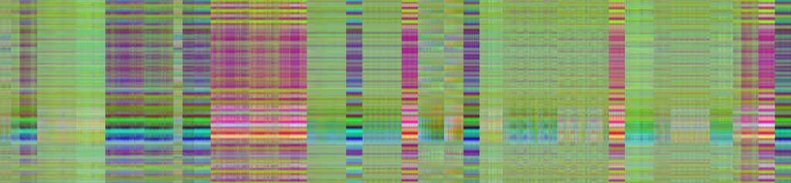
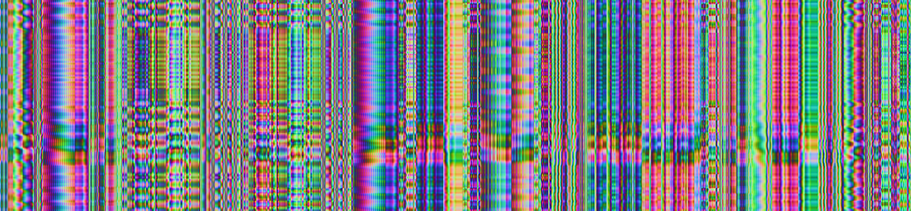

# Maya VAT Encoder
[](https://www.autodesk.com/products/maya)
[](https://www.python.org/)
[](LICENSE)
[]()

🌐 [English](README.md) | 한국어 · 🔗 **[프로젝트 페이지](https://5hyuns.github.io/Maya-Vertex-Animation-Texture-Baker/)** · ⬇️ **[다운로드](https://github.com/5hyuns/Maya-Vertex-Animation-Texture-Baker/releases/latest)**

**Maya용 Vertex Animation Texture 인코더** - 스킨메시, 디포머 등 움직이는 모든 것을 VAT로 변환해보세요!

**Houdini 없이 Maya 안에서** 스켈레탈(skinCluster)·블렌드쉐입·디포머 애니메이션을 **버텍스 애니메이션 텍스처(VAT)** 로 굽는 무료 오픈소스 툴입니다. Position/Normal 텍스처, 바운드 JSON, 프록시 FBX를 출력하며, 버텍스 셰이더로 언리얼 엔진·유니티·PlayCanvas·three.js(WebGL) 등에서 재생할 수 있습니다. 군중(crowd)이나 대량 인스턴스 애니메이션에 적합합니다.


<sub>*Astro Bot*™ © Sony Interactive Entertainment. Unofficial fan remake.</sub>

## 목차

- [특징](#특징)
- [설치](#설치)
- [빠른 시작](#빠른-시작)
- [옵션](#옵션)
- [출력 파일](#출력-파일)
- [출력 예시](#출력-예시)
- [텍스처 포맷](#텍스처-포맷)
- [엔진에서 재생하기](#엔진에서-재생하기)
- [Python API](#python-api)
- [주의사항](#주의사항)

---

## 특징

- **의존성 없음** - 순수 Python, 추가 설치 불필요
- **Target Engine** - PlayCanvas / WebGL, Unreal Engine, Unity의 축과 단위에 맞춰 베이크
- **Object/World Space** - 용도에 맞는 좌표계 선택
- **자동 VAT UV 생성** - 버텍스 ID 기반 UV 자동 할당
- **Skip First Frame** - T-Pose 제외 옵션
- **원클릭 출력** - PNG + JSON + FBX 일괄 생성
- **기본으로 노멀 포함** - 회전하거나 휘는 메시도 노멀 텍스처로 라이팅이 맞게 유지
- **Unreal 셋업 스크립트** - 스크립트 하나로 텍스처·메시 설정과 VAT 머티리얼을 만들고, 그림자도 움직임을 따라감(Nanite 켬/끔 모두)
- **베이크 점검** - 움직임 없는 베이크, 노멀 누락, 하드 엣지, 엔진에 비해 너무 넓은 텍스처를 경고

---

## 설치

1. [최신 릴리스](https://github.com/5hyuns/Maya-Vertex-Animation-Texture-Baker/releases/latest)(또는 *Code > Download ZIP*)를 받아 압축을 풉니다.
2. 압축 푼 폴더(예: `Maya-Vertex-Animation-Texture-Baker-main`)의 이름을 **`maya_vat`** 으로 바꿉니다. 폴더 이름이 곧 파이썬 패키지 이름입니다.
3. `maya_vat` 폴더를 Maya 스크립트 경로에 복사합니다.
   ```
   # Windows
   C:/Users/<사용자>/Documents/maya/<버전>/scripts/

   # macOS
   ~/Library/Preferences/Autodesk/maya/<버전>/scripts/

   # Linux
   ~/maya/<버전>/scripts/
   ```
4. Maya를 재시작한 뒤 Script Editor에서 아래 빠른 시작 코드를 실행합니다.

**요구 사항:** Maya 2022 이상 (PySide2 / PySide6). FBX 플러그인(`fbxmaya`)은 메시를 내보낼 때만 필요합니다.

---

## 빠른 시작

```python
import maya_vat
maya_vat.show()
```

1. 애니메이션된 메시를 선택하고 **Target Mesh** 옆 `<<` 버튼을 누릅니다.
2. **Frame Range**(`Timeline` 버튼으로 타임라인 범위 입력), **Target Engine**, **Coordinate Space**, 옵션을 설정합니다.
3. **Output Directory**를 지정하고 **Encode VAT**를 누릅니다.

---

## 옵션


### Target Engine

엔진마다 FBX 임포터가 프록시 메시를 자기 축과 단위로 바꿉니다. 선택한 타깃은 오프셋과 노멀을 그 축과 단위로 저장합니다. 그래서 셰이더는 디코딩한 오프셋을 임포트된 버텍스 위치에 그대로 더하면 됩니다.

| 타깃 | 저장 데이터의 축 / 단위 | 노멀 |
|------|------------------------|------|
| **PlayCanvas / WebGL** (기본값) | Maya 축 (Y-up), 센티미터 | X 반전 |
| **Unreal Engine** | Z-up, 왼손 좌표계, 센티미터: `(x, y, z)` → `(x, z, y)` (Maya 씬이 Z-up이면 `(x, -y, z)`) | 위치와 같은 매핑 |
| **Unity** | Y-up, 왼손 좌표계, 미터: `(x, y, z)` → `(-x, y, z) × 0.01` | 위치와 같은 매핑 |

- Unreal과 Unity 타깃은 Maya 작업 단위와 상관없이 FBX를 센티미터로 씁니다.
- PlayCanvas 타깃은 GLB로 바꿀 때 FBX의 메시 축이 그대로 유지된다고 전제합니다. Blender의 glTF 익스포트는 **+Y Up**(기본값)일 때 버텍스 데이터를 `(x, z, -y)`로 바꾸므로 오프셋과 노멀이 메시와 어긋납니다.
- Unreal 매핑은 FBX 임포트 옵션 **Convert Scene = 켬**, **Force Front XAxis = 끔**(둘 다 기본값)을 전제로 합니다.
- Unreal은 임포트할 때 오브젝트 Transform을 Static Mesh 버텍스에 구워 넣습니다. **Object** space에서는 Unreal 타깃이 첫 프레임의 오브젝트 회전과 스케일을 오프셋과 노멀에 적용해서 임포트된 메시와 맞춥니다.
- Unity 매핑은 **Convert Units = 켬**(기본값)을 전제로 합니다. Unity는 오브젝트 Transform(Z-up 씬이면 업 축 회전까지)을 GameObject에 남기므로 Y-up, Z-up 씬 모두 동작합니다.
- 텍스처 레이아웃, UV, JSON 키는 모든 타깃이 같습니다. 엔진 설정은 [엔진에서 재생하기](#엔진에서-재생하기)를 보세요.

### Coordinate Space

| 옵션 | 사용 상황 |
|------|-----------|
| **Object (Local)** | 런타임에 캐릭터 이동/회전 필요 **(권장)** |
| **World** | Transform 고정 (배경 오브젝트 등) |

### Skip First Frame

| 상황 | 설정 |
|------|------|
| 첫 프레임이 T-Pose/Bind Pose | **ON** |
| 첫 프레임부터 애니메이션 시작 | **OFF** |

ON이면 첫 프레임은 프록시(기준) 포즈로만 쓰이고 텍스처에는 들어가지 않습니다. 그래서 텍스처 행이 하나 줄어듭니다.

### 기타 옵션

| 옵션 | 설명 |
|------|------|
| **Export Normals (separate texture)** | `<mesh>_vnrm.png`도 함께 출력합니다. 기본으로 켜져 있습니다. 끄면 엔진이 첫 프레임의 노멀을 그대로 쓰므로, 회전하거나 휘는 메시는 첫 프레임의 조명을 유지합니다. 이 경우 베이커가 경고합니다. |
| **Export Mesh (FBX)** | 첫 프레임 포즈의 프록시 메시 출력 |
| **UV Set Name** / **Overwrite if exists** | 생성할 VAT UV 세트 이름. Overwrite를 켜면 기존 세트를 지우고 다시 만듭니다. **Create VAT UV**는 UV 세트만 만듭니다. |

---

## 출력 파일

```
output_dir/
+-- <mesh>_vat/
    +-- <mesh>_vat.png       # Position 델타 텍스처
    +-- <mesh>_vnrm.png      # Normal 텍스처 (선택)
    +-- <mesh>_remap.json    # 디코딩용 min/max 바운드
    +-- <mesh>.fbx           # 프록시 메시 (선택)
    +-- <mesh>_ue_setup.py   # 언리얼 엔진 셋업 스크립트 (Unreal 타깃만)
```

메시 이름의 `:`와 `|`는 `_`로 바뀝니다.

---

## 출력 예시

위 데모의 Astro Bot 메시에서 실제로 구워낸 텍스처입니다. **버텍스 2253개 × 524 프레임**이라 텍스처 크기는 2253 × 524 px입니다 (아래 이미지는 가로 1024 px로 줄인 미리보기).

**Position 텍스처** (`_vat.png`)



**Normal 텍스처** (`_vnrm.png`)



보는 법:

- **세로 한 줄 = 버텍스 하나** (열 x = 버텍스 ID), **가로 한 줄 = 프레임 하나** (맨 위가 첫 프레임)입니다.
- **Position 텍스처:** 각 픽셀은 프록시 포즈에서 해당 버텍스가 이동한 XYZ 값을 JSON의 min/max로 RGB에 매핑한 것입니다. 색이 고르고 잔잔한 영역은 거의 움직이지 않는 버텍스이고, 채도가 강한 세로 띠는 팔·다리처럼 많이 움직이는 부위입니다. 가로 띠는 몸 전체가 함께 움직인 프레임입니다.
- **Normal 텍스처:** 각 픽셀은 버텍스 노멀을 -1..1에서 0..255로 매핑한 값입니다. 표면 방향에 따라 색이 달라서 Position보다 훨씬 다채롭게 보입니다.
- 버텍스 ID는 보통 모델링 순서를 따르기 때문에, 이웃한 열은 같은 부위인 경우가 많아 비슷한 패턴을 보입니다.

---

## 텍스처 포맷

```
Width  = 버텍스 수
Height = 프레임 수

        V0    V1    V2    V3   ...   Vn
      +-----+-----+-----+-----+---+-----+
  F0  | RGB | RGB | RGB | RGB |...| RGB |  <- Row 0
  F1  | RGB | RGB | RGB | RGB |...| RGB |  <- Row 1
  F2  | RGB | RGB | RGB | RGB |...| RGB |  <- Row 2
   :  |     |     |     |     |   |     |
      +-----+-----+-----+-----+---+-----+

픽셀 RGB = (deltaX, deltaY, deltaZ) normalized to 0-255
```

| 항목 | 값 |
|------|-----|
| 포맷 | 8-bit RGB PNG |
| Position | `delta = position(frame) - position(proxy)`, 축별로 전체 공통 min/max 하나로 리맵 |
| Normal | -1..1 → 0..255, [Target Engine](#target-engine)의 축 기준 (PlayCanvas: **X축 반전**) |
| VAT UV | `U = (vertex_id + 0.5) / vertex_count`, `V` = 첫 행의 중앙 |
| 프록시 | 프레임 범위 첫 프레임의 메시 포즈 |

### `<mesh>_remap.json`

```json
{
    "target": "unreal",
    "position": {
        "min": [-2.5, -1.0, -0.5],
        "max": [3.2, 4.5, 1.2],
        "frames": 60,
        "vertices": 1024,
        "space": "object"
    },
    "normal": {
        "min": [-1, -1, -1],
        "max": [1, 1, 1]
    }
}
```

`target`은 [Target Engine](#target-engine) 값(`playcanvas`, `unreal`, `unity`)입니다. `normal`은 노멀을 출력했을 때만 들어갑니다.

---

## 엔진에서 재생하기

버텍스 셰이더에서 `VAT_UV` 세트로 텍스처를 샘플링한 뒤, 디코딩한 오프셋을 프록시 위치에 더합니다.

```hlsl
// vatUV        : 버텍스의 VAT_UV
// frame        : 현재 프레임, 0 .. frames-1
// boundsMin/Max: remap.json의 position.min / position.max
float2 uv     = float2(vatUV.x, (frame + 0.5) / frames);
float3 enc    = tex2Dlod(_VatPosition, float4(uv, 0, 0)).rgb;
float3 offset = lerp(boundsMin, boundsMax, enc);
float3 posOS  = proxyPositionOS + offset;

float3 n = tex2Dlod(_VatNormal, float4(uv, 0, 0)).rgb * 2 - 1;
n.x = -n.x;   // PlayCanvas 타깃만: X 반전을 되돌려 Maya 축으로
```

텍스처 임포트 설정:

- 필터링은 **Point / Nearest**, **밉맵 끔**
- **Linear** (sRGB 끔), **압축 없음**
- 엔진이 텍스처를 V 반전 상태로 읽는다면 V를 뒤집어 주세요 (예: `1 - v`).

8-bit 정밀도는 축별로 `(max - min) / 255`입니다. 움직임 범위가 클수록 단계가 거칠어집니다.

### Unreal Engine

**Target Engine = Unreal Engine**으로 베이크합니다.

**셋업 스크립트(`<mesh>_ue_setup.py`):** FBX와 텍스처를 콘텐츠 브라우저의 한 폴더에 임포트하고, 스태틱 메시를 선택한 뒤 스크립트를 실행합니다(Tools > Execute Python Script). 아래 설정을 모두 적용하고, 이 섹션의 노드로 `M_<mesh>_VAT`를 만들어 메시에 지정합니다. 엔진의 Python이 **World Position Offset**을 연결하지 못하는 버전(예: Unreal Engine 5.4)에서는 연결할 노드에 "Connect to World Position Offset"이 표시되니, 그 핀 하나만 직접 연결하세요. 이 섹션의 나머지는 같은 설정을 손으로 하는 방법입니다.

**FBX 임포트 (Static Mesh):** **Convert Scene**은 켜고 **Force Front XAxis**는 끈 상태로 둡니다(기본값). Interchange 임포터에서는 소스 파일 옆 `...` 메뉴에 있습니다.

**Static Mesh 에디터:**

- **Build Settings > Use Full Precision UVs: 켬.** Unreal은 기본으로 UV를 16-bit float로 저장합니다. 그래서 텍스처 가로가 버텍스 약 1000개를 넘으면 픽셀 하나를 정확히 가리키지 못합니다. 버텍스가 옆 열을 읽어서 메시가 찢어집니다.
- **Nanite: 끔.** Nanite를 켜면 아래 바운드 확장이 World Position Offset을 덮지 못하고, 그림자를 맞게 유지하는 것은 머티리얼의 **Max World Position Offset Displacement**(머티리얼 항목 참고)입니다. 이 값이 없으면 움직이는 메시가 바닥에 그림자 자국을 남기거나(UE5 기본값인 Virtual Shadow Map) 그림자를 잃습니다.
- **Positive Bounds Extension = `position.max`**, **Negative Bounds Extension = 부호를 뒤집은 `position.min`**(`remap.json` 값이며, Encode VAT 대화상자에도 표시됩니다). 언리얼은 첫 프레임 포즈로 바운드를 계산하는데, 이 값을 넣으면 모든 프레임의 모든 버텍스를 덮습니다. 바운드가 작으면 움직이는 동안 메시가 컬링되고, 그림자는 첫 프레임 포즈 근처에서만 그려집니다. 바운드나 Nanite 설정을 바꾼 뒤에는 레벨을 다시 열어 이전에 캐시된 그림자를 지우세요.

**텍스처 (`_vat.png`, `_vnrm.png`):**

| 설정 | 값 |
|------|-----|
| Compression Settings | `VectorDisplacementmap (RGBA8)` |
| sRGB | 끔 |
| Filter | `Nearest` |
| Mip Gen Settings | `NoMipmaps` |

**머티리얼:** **Custom** 노드를 추가합니다. 입력은 `VatTex`(Texture Object), `VatUV`(`VAT_UV` 인덱스의 `TexCoord`, 보통 **1**), `Frame`, `Frames`, `BoundsMin`, `BoundsMax`이고 출력 타입은 `CMOT Float 3`입니다.

```hlsl
float2 uv  = float2(VatUV.x, (floor(Frame) + 0.5) / Frames);
float3 enc = Texture2DSampleLevel(VatTex, VatTexSampler, uv, 0).rgb;
return lerp(BoundsMin, BoundsMax, enc);
```

- `Frames`, `BoundsMin`, `BoundsMax`는 `remap.json`의 `position.frames`, `position.min`, `position.max`입니다. 이 값을 `BoundsMin`/`BoundsMax` 상수에 입력하세요. 둘 다 0이면 메시가 움직이지 않습니다. `Frame`은 `fmod(Time * FPS, Frames)`처럼 만들 수 있습니다.
- **Object** space로 구웠다면 결과를 **TransformVector (Local Space → World Space)**를 거쳐 **World Position Offset**에 연결합니다. **World** space로 구웠다면 바로 연결합니다.
- 머티리얼의 **Max World Position Offset Displacement**를 `sqrt(X² + Y² + Z²)`로 설정합니다. 각 축 값은 `|position.min|`과 `|position.max|` 중 큰 쪽입니다. 컬링과 그림자가 Nanite 여부와 관계없이 이 거리만큼 넓어집니다. 값이 작으면 움직임이 잘릴 수 있습니다.
- 노멀: 버텍스 단계에서 디코딩합니다. 같은 코드의 Custom 노드를 하나 더 만들어 `_vnrm.png`에 연결하고 `BoundsMin = -1`, `BoundsMax = 1`로 둡니다(`rgb * 2 - 1`과 같음). Object 스페이스로 베이크했다면 결과를 Local → World로 변환합니다. 그 값을 **VertexInterpolator** 노드에 통과시키고, 인터폴레이터 출력을 **Normal**에 연결한 뒤 머티리얼 디테일에서 **Tangent Space Normal**을 끕니다. 노멀 텍스처를 픽셀 단계에서 샘플링하면 안 됩니다. 픽셀 단계에서는 `VAT_UV`가 삼각형 안에서 보간되어 이웃 버텍스의 열을 읽게 됩니다.
- 노멀 텍스처가 없으면 World Position Offset이 버텍스는 옮기지만 메시는 첫 프레임의 노멀을 유지합니다. 그래서 뒤집히는 메시는 각 면을 첫 프레임 방향 그대로 비춥니다. 예를 들어 위로 돌아온 면이 계속 어둡게 보입니다.
- 노멀 텍스처 없이 각진 메시를 쓰려면 머티리얼에서 플랫 노멀을 만들 수 있습니다. **Normalize(Cross(DDX(Absolute World Position), DDY(Absolute World Position)))**를 **Normal**에 연결하고(A/B 순서를 지키세요. 반대로 하면 노멀이 안쪽을 향합니다) **Tangent Space Normal**을 끕니다. 모든 삼각형이 평평하게 셰이딩되므로 매끈한 표면은 각져 보입니다.

### Unity

**Target Engine = Unity**로 베이크합니다.

**모델 임포트:** **Convert Units: 켬**, **Mesh Compression: Off**(둘 다 기본값). `VAT_UV`는 두 번째 UV 채널입니다(`TEXCOORD1` / Shader Graph `UV1`).

**텍스처:** sRGB 끔, **Non-Power of 2: None**, **Generate Mip Maps: 끔**, **Filter Mode: Point**, **Compression: None**, **Wrap Mode: Clamp**. 기본값인 *Non-Power of 2: ToNearest*는 텍스처 크기를 바꿔서 열 조회가 깨집니다.

Unity 텍스처는 V = 0이 맨 아래 행이므로 프레임 행을 위에서부터 읽습니다.

```hlsl
float2 uv     = float2(vatUV.x, 1.0 - (frame + 0.5) / frames);
float3 enc    = tex2Dlod(_VatPosition, float4(uv, 0, 0)).rgb;
float3 posOS  = v.vertex.xyz + lerp(_BoundsMin, _BoundsMax, enc);   // object space, 미터
float3 nrmOS  = tex2Dlod(_VatNormal, float4(uv, 0, 0)).rgb * 2 - 1;
```

**World** space로 구웠다면 오프셋은 Unity 월드 축 기준입니다. 오브젝트→월드 변환 뒤에 더하세요. 예: `posWS = TransformObjectToWorld(v.vertex.xyz) + lerp(_BoundsMin, _BoundsMax, enc)`. 월드 스페이스 오프셋은 그 포즈에서만 맞으므로, FBX를 임포트했을 때의 오브젝트 트랜스폼을 그대로 두세요. 노멀 텍스처는 어느 방식으로 굽든 오브젝트 스페이스이므로, `nrmOS`는 항상 오브젝트→월드 노멀 변환으로 바꿉니다.

---

## Python API

### VAT 인코딩

```python
from maya_vat import core, utils

result = core.encode_vat(
    mesh_name="pCube1",
    output_dir="C:/output",
    frame_start=0,
    frame_end=60,
    include_normals=True,
    export_mesh=True,
    use_world_space=False,      # Object Space 권장
    uv_set_name="VAT_UV",
    force_uv=False,
    skip_first_frame=True,      # T-Pose 제외
    target_engine="unreal"     # "playcanvas"(기본값), "unreal", "unity"
)

# 반환값
# {
#     "success": True,
#     "png_path": "C:/output/pCube1_vat/pCube1_vat.png",
#     "json_path": "C:/output/pCube1_vat/pCube1_remap.json",
#     "fbx_path": "C:/output/pCube1_vat/pCube1.fbx",
#     "width": 8,
#     "height": 60,
#     "bounds_extension": {"positive": [x, y, z], "negative": [x, y, z]},
#     "setup_script_path": "C:/output/pCube1_vat/pCube1_ue_setup.py",  # Unreal만
#     "warnings": [],              # Encode VAT 대화상자에도 표시되는 메시지
#     ...
# }
```

### VAT UV 독립 생성

```python
uv_result = utils.create_vat_uv(
    mesh_name="pCube1",
    num_verts=1024,
    num_frames=60,
    uv_set_name="VAT_UV",
    force=False  # 존재하면 스킵
)

# UV 세트 존재 확인
exists = utils.uv_set_exists("pCube1", "VAT_UV")
```

### 패키지 구조

```
maya_vat/
+-- __init__.py      # 패키지 진입점 (show, encode_vat)
+-- core.py          # VAT 인코딩 로직, PNG 저장
+-- utils.py         # Maya API 유틸리티, VAT UV 생성
+-- exporter.py      # FBX/OBJ 내보내기
+-- unreal_setup.py  # 언리얼 엔진 셋업 스크립트 작성
+-- ui.py            # PySide2/6 UI
```

---

## 주의사항

### Object Space vs World Space

| 상황 | Object | World |
|------|:------:|:-----:|
| 런타임 이동/회전 | O | X |
| 루트 모션 애니메이션 | O | X (중복 이동) |
| Transform 고정 | O | O |

### UV 세트

- 기존 UV 세트와 이름이 겹치지 않게 주의하세요.
- `Overwrite if exists`를 체크하면 기존 UV 세트를 지우고 다시 만듭니다.
- UV Editor > UV Sets에서 확인할 수 있습니다.

### FBX 내보내기

- 스킨/본 제외 (VAT는 스킨 불필요)
- 블렌드쉐입 제외
- 애니메이션 제외 (첫 프레임만)
- 시작 프레임이 바인드 포즈가 아니어도 시작 프레임의 포즈 그대로 내보냅니다
- 메시의 부모 그룹과 노드 이름을 그대로 유지합니다. 레퍼런스 캐릭터는 맨 위 그룹만 네임스페이스가 빠지고(`ch:rig` → `rig`), 메시는 이름을 그대로 유지합니다(예: `ch:body`)
- Unreal과 Unity 타깃은 센티미터로 씁니다

### 제한 사항

- 프레임 범위 전체에서 버텍스 수와 순서가 같아야 합니다 (토폴로지가 바뀌는 애니메이션은 지원하지 않음).
- **Object** space는 변형(스킨, 블렌드셰이프, 디포머)만 기록하고, 오브젝트 자체의 이동/회전/스케일 키는 기록하지 않습니다. Transform만 애니메이션된 메시는 `min`/`max`가 모두 0인 빈 텍스처로 구워집니다. **World** space로 굽거나 디포머로 움직이세요. 움직임이 없는 베이크면 베이커가 경고합니다.
- 텍스처 가로 크기 = 버텍스 수입니다. 하이폴리 메시라면 대상 엔진의 최대 텍스처 크기를 확인하세요. 한 변이 8192 px을 넘으면 베이커가 경고합니다.
- 노멀 텍스처는 버텍스마다 노멀을 하나만 저장하므로, 노멀 텍스처를 쓰면 하드 엣지가 부드럽게 보입니다. 하드 엣지를 유지하려면 베이크 전에 Maya에서 그 엣지를 분리하세요(Edit Mesh > Detach). 그러면 양쪽 면이 각자 버텍스를 갖습니다. 두 면 사이에 하드 엣지가 있으면 베이커가 경고합니다.

---

## License

[MIT License](LICENSE)

---

**Contact:** 555hyuns@gmail.com
