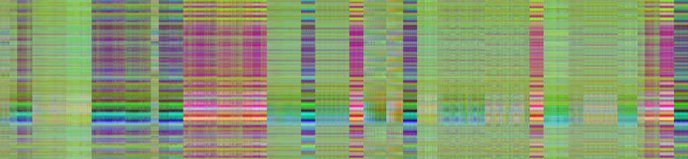
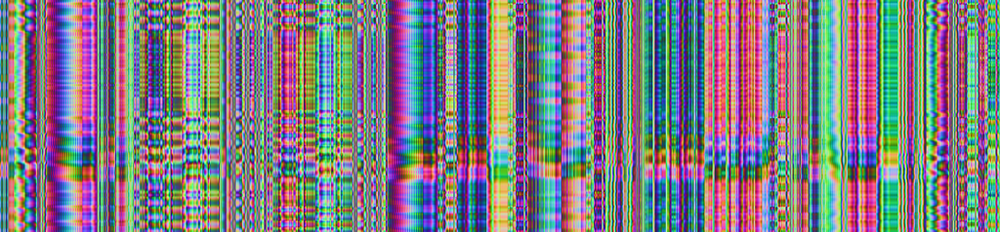

# Maya VAT Encoder
[](https://www.autodesk.com/products/maya)
[](https://www.python.org/)
[](LICENSE)
[]()

🌐 English | [한국어](README.ko.md) · 🔗 **[Project Page](https://5hyuns.github.io/Maya-Vertex-Animation-Texture-Baker/)** · ⬇️ **[Download](https://github.com/5hyuns/Maya-Vertex-Animation-Texture-Baker/releases/latest)**

**Vertex Animation Texture Encoder for Maya** - Convert skinned meshes, deformers, and anything that moves into VAT!

A free, open-source **Maya VAT baker** — bake skeletal (skinCluster), blend shape, and deformer animation into **vertex animation textures** directly inside Autodesk Maya, **no Houdini required**. Outputs a position texture, optional normal texture, bounds JSON and a proxy FBX that you can play back with a vertex shader in real-time engines (Unreal Engine, Unity, PlayCanvas, three.js / WebGL) — ideal for crowds and large numbers of animated instances.


<sub>*Astro Bot*™ © Sony Interactive Entertainment. Unofficial fan remake.</sub>

## Contents

- [Features](#features)
- [Installation](#installation)
- [Quick Start](#quick-start)
- [Options](#options)
- [Output](#output)
- [Example Output](#example-output)
- [Texture Format](#texture-format)
- [Playing VAT in an Engine](#playing-vat-in-an-engine)
- [Python API](#python-api)
- [Notes](#notes)

---

## Features

- **Zero Dependencies** - Pure Python, no additional installation required
- **Target Engine** - Bake for PlayCanvas / WebGL, Unreal Engine or Unity axes and units
- **Object/World Space** - Choose coordinate space for your needs
- **Auto VAT UV Generation** - Automatic UV assignment based on vertex ID
- **Skip First Frame** - Option to exclude T-Pose
- **One-Click Export** - Batch generation of PNG + JSON + FBX

---

## Installation

1. Download the [latest release](https://github.com/5hyuns/Maya-Vertex-Animation-Texture-Baker/releases/latest) (or *Code > Download ZIP*) and extract it.
2. **Rename** the extracted folder (e.g. `Maya-Vertex-Animation-Texture-Baker-main`) to **`maya_vat`** — the folder name is the Python package name.
3. Copy the `maya_vat` folder to your Maya scripts path:
   ```
   # Windows
   C:/Users/<username>/Documents/maya/<version>/scripts/

   # macOS
   ~/Library/Preferences/Autodesk/maya/<version>/scripts/

   # Linux
   ~/maya/<version>/scripts/
   ```
4. Restart Maya, then run the Quick Start code in the Script Editor.

**Requirements:** Maya 2022 or later (PySide2 / PySide6). The FBX plugin (`fbxmaya`) is needed only for mesh export.

---

## Quick Start

```python
import maya_vat
maya_vat.show()
```

1. Select the animated mesh and click `<<` next to **Target Mesh**.
2. Set the **Frame Range** (`Timeline` fills it from the timeline), **Target Engine**, **Coordinate Space** and options.
3. Choose an **Output Directory** and click **Encode VAT**.

---

## Options


### Target Engine

Each engine's FBX importer converts the proxy mesh to its own axes and units. The selected target stores the offsets and normals in those same axes and units, so the shader adds the decoded offset to the imported vertex position as is.

| Target | Axes / units of the stored data | Normal |
|--------|---------------------------------|--------|
| **PlayCanvas / WebGL** (default) | Maya axes (Y-up), centimeters | X negated |
| **Unreal Engine** | Z-up, left-handed, centimeters: `(x, y, z)` → `(x, z, y)` (`(x, -y, z)` for a Z-up Maya scene) | Same mapping as positions |
| **Unity** | Y-up, left-handed, meters: `(x, y, z)` → `(-x, y, z) × 0.01` | Same mapping as positions |

- Unreal and Unity targets write the FBX in centimeters, whatever the Maya working unit is.
- The PlayCanvas target expects the mesh to keep the FBX mesh axes when it becomes a GLB. Blender's glTF export with **+Y Up** (its default) rewrites the vertex data as `(x, z, -y)`, so the offsets and normals no longer line up with the mesh.
- The Unreal mapping assumes the FBX import options **Convert Scene = on** and **Force Front XAxis = off** (both defaults).
- Unreal bakes the object's transform into the static mesh vertices on import. With **Object** space, the Unreal target applies the object's rotation and scale at the first frame to the offsets and normals so they match the imported mesh.
- The Unity mapping assumes **Convert Units = on** (default). Unity keeps the object transform (and the up-axis rotation of a Z-up scene) on the GameObject, so Y-up and Z-up scenes both work.
- The texture layout, UV and JSON keys are the same for every target. See [Playing VAT in an Engine](#playing-vat-in-an-engine) for the engine setup.

### Coordinate Space

| Option | Use Case |
|--------|----------|
| **Object (Local)** | Character needs runtime movement/rotation **(Recommended)** |
| **World** | Fixed transform (background objects, etc.) |

### Skip First Frame

| Situation | Setting |
|-----------|---------|
| First frame is T-Pose/Bind Pose | **ON** |
| Animation starts from first frame | **OFF** |

With this ON, the first frame is still used as the proxy (rest) pose but is left out of the texture, so the texture has one fewer row.

### Other Options

| Option | Description |
|--------|-------------|
| **Export Normals (separate texture)** | Also writes `<mesh>_vnrm.png`. On by default. Without it the engine keeps the first-frame normals, so a mesh that turns or bends keeps its first-frame lighting; the baker warns when that happens. |
| **Export Mesh (FBX)** | Exports the proxy mesh at the first frame |
| **UV Set Name** / **Overwrite if exists** | Name of the VAT UV set to create. With overwrite on, an existing set is deleted and regenerated. **Create VAT UV** creates only the UV set. |

---

## Output

```
output_dir/
+-- <mesh>_vat/
    +-- <mesh>_vat.png       # Position delta texture
    +-- <mesh>_vnrm.png      # Normal texture (optional)
    +-- <mesh>_remap.json    # Min/max bounds for decoding
    +-- <mesh>.fbx           # Proxy mesh (optional)
    +-- <mesh>_ue_setup.py   # Unreal Engine setup script (Unreal target only)
```

`:` and `|` in mesh names are replaced with `_`.

---

## Example Output

These are the real textures baked from the Astro Bot mesh in the demo above: **2253 vertices × 524 frames**, so each texture is 2253 × 524 px (the previews below are resized to 1024 px wide).

**Position texture** (`_vat.png`)



**Normal texture** (`_vnrm.png`)



How to read them:

- **One column = one vertex** (column x = vertex ID). **One row = one frame** (the top row is the first frame).
- **Position texture:** each pixel is the vertex's XYZ offset from the proxy pose, remapped to RGB using the min/max in the JSON. Calm, uniform areas are vertices that barely move. Saturated vertical bands are parts that move a lot, such as the arms and legs. Horizontal bands are frames where the whole body moves together.
- **Normal texture:** each pixel is the vertex normal, remapped from -1..1 to 0..255. It changes with the surface direction, so it is far more colorful than the position texture.
- Neighboring columns look similar because vertex IDs tend to follow the modeling order, so nearby vertices often belong to the same body part.

---

## Texture Format

```
Width  = Number of vertices
Height = Number of frames

        V0    V1    V2    V3   ...   Vn
      +-----+-----+-----+-----+---+-----+
  F0  | RGB | RGB | RGB | RGB |...| RGB |  <- Row 0
  F1  | RGB | RGB | RGB | RGB |...| RGB |  <- Row 1
  F2  | RGB | RGB | RGB | RGB |...| RGB |  <- Row 2
   :  |     |     |     |     |   |     |
      +-----+-----+-----+-----+---+-----+

Pixel RGB = (deltaX, deltaY, deltaZ) normalized to 0-255
```

| Item | Value |
|------|-------|
| Format | 8-bit RGB PNG |
| Position | `delta = position(frame) - position(proxy)`, remapped per axis with a single global min/max |
| Normal | -1..1 → 0..255, in the axes of the [Target Engine](#target-engine) (PlayCanvas: **X axis negated**) |
| VAT UV | `U = (vertex_id + 0.5) / vertex_count`, `V` = center of the first row |
| Proxy | Mesh pose at the first frame of the range |

### `<mesh>_remap.json`

```json
{
    "target": "unreal",
    "position": {
        "min": [-2.5, -1.0, -0.5],
        "max": [3.2, 4.5, 1.2],
        "frames": 60,
        "vertices": 1024,
        "space": "object"
    },
    "normal": {
        "min": [-1, -1, -1],
        "max": [1, 1, 1]
    }
}
```

`target` is the [Target Engine](#target-engine) (`playcanvas`, `unreal` or `unity`). `normal` is present only when normals are exported.

---

## Playing VAT in an Engine

In the vertex shader, sample the texture with the `VAT_UV` set and add the decoded offset to the proxy position.

```hlsl
// vatUV        : VAT_UV of the vertex
// frame        : current frame, 0 .. frames-1
// boundsMin/Max: position.min / position.max from remap.json
float2 uv     = float2(vatUV.x, (frame + 0.5) / frames);
float3 enc    = tex2Dlod(_VatPosition, float4(uv, 0, 0)).rgb;
float3 offset = lerp(boundsMin, boundsMax, enc);
float3 posOS  = proxyPositionOS + offset;

float3 n = tex2Dlod(_VatNormal, float4(uv, 0, 0)).rgb * 2 - 1;
n.x = -n.x;   // PlayCanvas target only: undo the X flip to get Maya axes
```

Texture import settings:

- **Point / Nearest** filtering, **no mipmaps**
- **Linear** (turn sRGB off), **no compression**
- If your engine loads textures with V flipped, flip V (for example `1 - v`).

8-bit precision is `(max - min) / 255` per axis, so larger motion ranges give coarser steps.

### Unreal Engine

Bake with **Target Engine = Unreal Engine**.

**Setup script (`<mesh>_ue_setup.py`):** import the FBX and the textures into one Content Browser folder, select the static mesh, and run the script (Tools > Execute Python Script). It applies every setting below and builds `M_<mesh>_VAT` with the nodes described in this section, then assigns it to the mesh. Where the engine's Python cannot connect **World Position Offset** (Unreal Engine 5.4, for example), the node to connect is marked "Connect to World Position Offset"; connect that one pin by hand. The rest of this section describes the same setup for doing it by hand.

**FBX import (Static Mesh):** keep **Convert Scene** on and **Force Front XAxis** off (the defaults; in the Interchange importer they are under the `...` menu next to the source file).

**Static Mesh editor:**

- **Build Settings > Use Full Precision UVs: on.** Unreal stores UVs as 16-bit floats by default, which cannot address single pixels once the texture is wider than about 1000 vertices. Vertices then read their neighbors' columns and the mesh tears.
- **Nanite: off.** With Nanite on, the bounds extension below does not cover the World Position Offset: without it the moving mesh leaves shadow trails on the ground (Virtual Shadow Maps, the UE5 default), and with it the shadow disappears.
- **Positive Bounds Extension = `position.max`** and **Negative Bounds Extension = `position.min` with the sign flipped** (from `remap.json`; the Encode VAT dialog shows both). Unreal computes the bounds from the first-frame pose, and these values make them cover every vertex in every frame. With smaller bounds the mesh is culled while it moves, and its shadow is only drawn near the first-frame pose. Reopen the level after changing the bounds or Nanite to clear shadows cached before the change.

**Textures (`_vat.png`, `_vnrm.png`):**

| Setting | Value |
|---------|-------|
| Compression Settings | `VectorDisplacementmap (RGBA8)` |
| sRGB | off |
| Filter | `Nearest` |
| Mip Gen Settings | `NoMipmaps` |

**Material:** add a **Custom** node with the inputs `VatTex` (Texture Object), `VatUV` (`TexCoord` with the `VAT_UV` index, usually **1**), `Frame`, `Frames`, `BoundsMin`, `BoundsMax`, and the output type `CMOT Float 3`:

```hlsl
float2 uv  = float2(VatUV.x, (floor(Frame) + 0.5) / Frames);
float3 enc = Texture2DSampleLevel(VatTex, VatTexSampler, uv, 0).rgb;
return lerp(BoundsMin, BoundsMax, enc);
```

- `Frames`, `BoundsMin`, `BoundsMax` come from `remap.json` (`position.frames`, `position.min`, `position.max`). Type the values into the `BoundsMin`/`BoundsMax` constants; if both stay 0, the mesh does not move. `Frame` can be `fmod(Time * FPS, Frames)`.
- With an **Object** space bake, connect the result through **TransformVector (Local Space → World Space)** to **World Position Offset**. With a **World** space bake, connect it directly.
- Normals: decode them in the vertex stage. Use a second Custom node with the same code on `_vnrm.png` and `BoundsMin = -1`, `BoundsMax = 1` (this gives `rgb * 2 - 1`). With an Object space bake, transform the result Local → World. Pass it through a **VertexInterpolator** node, connect the interpolator output to **Normal**, and turn off **Tangent Space Normal** in the material details. Do not sample the normal texture in the pixel stage: `VAT_UV` is interpolated across each triangle there, so the lookup reads neighboring vertices' columns.
- Without the normal texture, World Position Offset moves the vertices but the mesh keeps its first-frame normals. A mesh that turns over then lights each face as it faced on the first frame, for example a face that turns up stays dark.
- For a hard-edged mesh without a normal texture, flat normals can come from the material instead: connect **Normalize(Cross(DDX(Absolute World Position), DDY(Absolute World Position)))** to **Normal** (keep this A/B order; the reverse points the normals inward) and turn off **Tangent Space Normal**. Every triangle is then lit flat, so smooth surfaces look faceted.

### Unity

Bake with **Target Engine = Unity**.

**Model import:** **Convert Units: on**, **Mesh Compression: Off** (both defaults). `VAT_UV` is the second UV channel (`TEXCOORD1` / Shader Graph `UV1`).

**Textures:** sRGB off, **Non-Power of 2: None**, **Generate Mip Maps: off**, **Filter Mode: Point**, **Compression: None**, **Wrap Mode: Clamp**. The default *Non-Power of 2: ToNearest* resizes the texture and breaks the column lookup.

Unity textures have V = 0 at the bottom row, so read the frame row from the top:

```hlsl
float2 uv     = float2(vatUV.x, 1.0 - (frame + 0.5) / frames);
float3 enc    = tex2Dlod(_VatPosition, float4(uv, 0, 0)).rgb;
float3 posOS  = v.vertex.xyz + lerp(_BoundsMin, _BoundsMax, enc);   // object space, meters
float3 nrmOS  = tex2Dlod(_VatNormal, float4(uv, 0, 0)).rgb * 2 - 1;
```

With a **World** space bake, the offset is in Unity world axes. Add it after the object-to-world transform instead, for example `posWS = TransformObjectToWorld(v.vertex.xyz) + lerp(_BoundsMin, _BoundsMax, enc)`. Keep the object's transform from the FBX import, because world-space offsets only fit that pose. The normal texture stays in object space with either bake, so always transform `nrmOS` with the object-to-world normal transform.

---

## Python API

### VAT Encoding

```python
from maya_vat import core, utils

result = core.encode_vat(
    mesh_name="pCube1",
    output_dir="C:/output",
    frame_start=0,
    frame_end=60,
    include_normals=True,
    export_mesh=True,
    use_world_space=False,      # Object Space recommended
    uv_set_name="VAT_UV",
    force_uv=False,
    skip_first_frame=True,      # Exclude T-Pose
    target_engine="unreal"     # "playcanvas" (default), "unreal" or "unity"
)

# Returns
# {
#     "success": True,
#     "png_path": "C:/output/pCube1_vat/pCube1_vat.png",
#     "json_path": "C:/output/pCube1_vat/pCube1_remap.json",
#     "fbx_path": "C:/output/pCube1_vat/pCube1.fbx",
#     "width": 8,
#     "height": 60,
#     "bounds_extension": {"positive": [x, y, z], "negative": [x, y, z]},
#     "setup_script_path": "C:/output/pCube1_vat/pCube1_ue_setup.py",  # Unreal only
#     "warnings": [],              # Messages also shown in the Encode VAT dialog
#     ...
# }
```

### Standalone VAT UV Generation

```python
uv_result = utils.create_vat_uv(
    mesh_name="pCube1",
    num_verts=1024,
    num_frames=60,
    uv_set_name="VAT_UV",
    force=False  # Skip if exists
)

# Check if UV set exists
exists = utils.uv_set_exists("pCube1", "VAT_UV")
```

### Package Layout

```
maya_vat/
+-- __init__.py      # Package entry point (show, encode_vat)
+-- core.py          # VAT encoding logic, PNG writer
+-- utils.py         # Maya API utilities, VAT UV creation
+-- exporter.py      # FBX/OBJ export
+-- unreal_setup.py  # Writes the Unreal Engine setup script
+-- ui.py            # PySide2/6 UI
```

---

## Notes

### Object Space vs World Space

| Situation | Object | World |
|-----------|:------:|:-----:|
| Runtime movement/rotation | O | X |
| Root motion animation | O | X (double transformation) |
| Fixed transform | O | O |

### UV Sets

- Avoid name conflicts with existing UV sets.
- Checking `Overwrite if exists` deletes and regenerates the existing UV set.
- Verify in UV Editor > UV Sets.

### FBX Export

- Skinning-free (VAT replaces skeletal deformation)
- Excludes blend shapes
- Excludes animation (first frame only)
- Unreal and Unity targets write the file in centimeters

### Limitations

- The vertex count and order must stay the same for the whole frame range (topology-changing animation is not supported).
- **Object** space records only deformation (skin, blend shapes, deformers), not the object's own translate/rotate/scale keys. A mesh animated only by its transform bakes to an empty texture with `min`/`max` all 0. Bake it in **World** space, or move it with a deformer. The baker warns when the bake has no motion.
- Texture width equals the vertex count. Check your target engine's maximum texture size for high-poly meshes. The baker warns when a side exceeds 8192 px.
- The normal texture stores one normal per vertex, so hard edges render smooth when you use it. To keep a hard edge, split it in Maya before baking (Edit Mesh > Detach), so each side gets its own vertex. The baker warns when the mesh has hard edges between two faces.

---

## License

[MIT License](LICENSE)

---

**Contact:** 555hyuns@gmail.com
